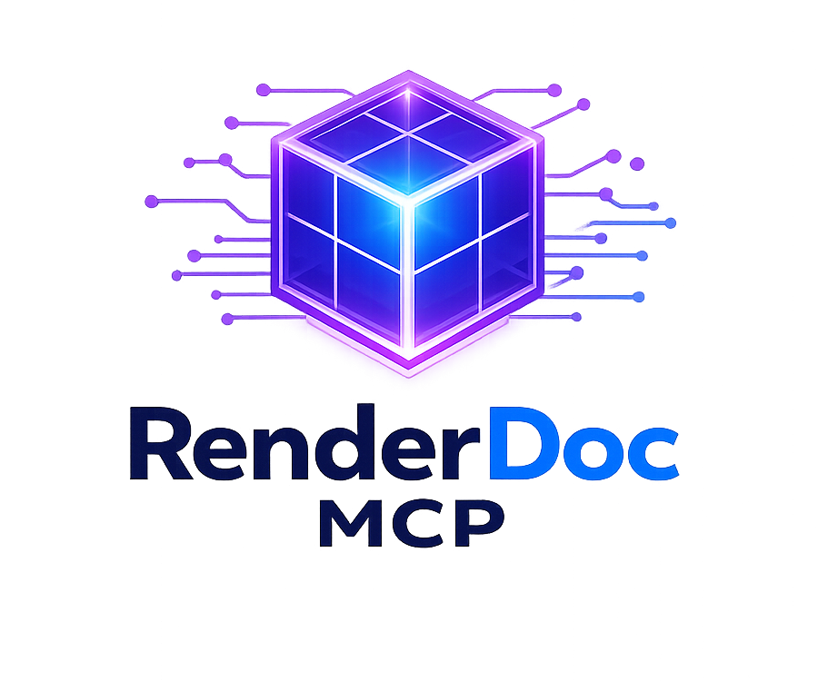
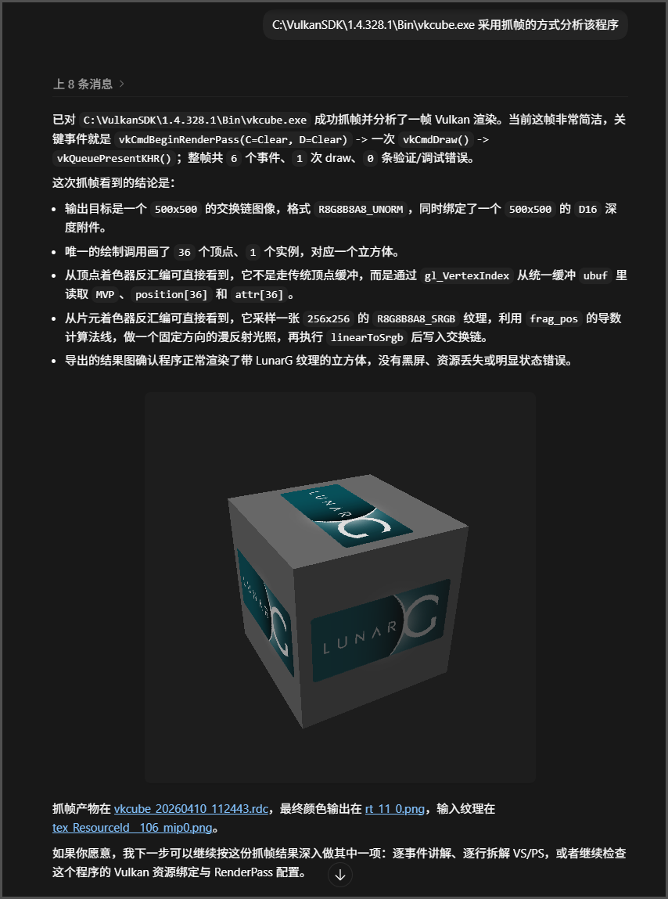
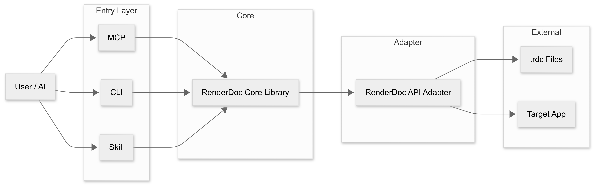

<p align="center">
  <br>
  <b>面向 AI 的 RenderDoc GPU 帧调试工具</b><br><br>
  <a href="https://github.com/JiaboLi-GitHub/renderdoc-mcp/actions/workflows/ci.yml"></a>
  <a href="LICENSE"></a><br>
  <a href="https://oosmetrics.com/repo/JiaboLi-GitHub/renderdoc-mcp"></a>
  <a href="https://oosmetrics.com/repo/JiaboLi-GitHub/renderdoc-mcp"></a><br>
  <a href="README.md">English</a> | <b>简体中文</b>
</p>

---

renderdoc-mcp 是一个基于 RenderDoc Replay API 的 MCP Server 和 CLI，提供 **59 个结构化工具**，让 AI 助手（Claude、Codex 等）可以直接打开 `.rdc` 抓帧、分析 GPU 帧、调试 Shader/像素、对比抓帧、导出证据 — 无需手动操作 UI。

## 演示

<p align="center">
  
</p>

## 功能概览

| 模块 | 能力 |
|------|------|
| 会话与抓帧 | 打开抓帧、实时抓帧、查看元信息 |
| 帧导航 | 列出事件/draw call、跳转到任意事件 |
| 管线与 Shader | 查看管线状态、绑定、Shader 源码、常量缓冲区 |
| 资源与 Pass | 分析帧结构、pass 依赖、资源使用情况 |
| 像素与 Shader 调试 | 像素历史、拾取像素、调试像素/顶点/线程 |
| 导出 | 渲染目标、纹理、Buffer、Mesh、快照 |
| Diff 与断言 | 对比两次抓帧，断言像素/状态/图片用于 CI |

## 下载

从 [GitHub Releases](https://github.com/JiaboLi-GitHub/renderdoc-mcp/releases) 获取最新发布包。压缩包内容：

| 文件 | 说明 |
|------|------|
| `bin/renderdoc-mcp.exe` | MCP Server（stdio） |
| `bin/renderdoc-cli.exe` | CLI，用于 Shell 和 CI |
| `bin/renderdoc.dll` / `renderdoc.json` | 内置的 RenderDoc 运行时 |
| `skills/renderdoc-mcp/` | Codex 工作流 skill |
| `install-codex.ps1` | Codex Desktop 一键安装脚本 |

手动运行 CI 时，将版本留空即可只运行测试。要同时发布版本，请填写版本标签（例如 `v1.0.0`），并可选择草稿或预发布。发布任务独立于 CI 测试任务运行。

## 客户端配置

服务器协商使用 MCP 协议版本 `2025-03-26`。请求更新版本的客户端也必须支持此版本。

### Codex Desktop

安装脚本会自动配置 `~/.codex/config.toml`。也可手动添加：

```toml
[mcp_servers.renderdoc-mcp]
command = 'renderdoc-mcp.exe'
args = []
```

### Claude Code

```json
{
  "mcpServers": {
    "renderdoc-mcp": {
      "command": "renderdoc-mcp.exe",
      "args": []
    }
  }
}
```

### 故障排查 / 日志

传入 `--log-file <绝对路径>`（或设置环境变量 `RENDERDOC_MCP_LOG`）即可将每个请求、响应、错误及退出原因以带时间戳的形式写入日志：

```json
{
  "servers": {
    "renderdoc-mcp": {
      "command": "renderdoc-mcp.exe",
      "args": ["--log-file", "C:\\Temp\\renderdoc-mcp.log"]
    }
  }
}
```

请求处理中发生的原生崩溃（例如 RenderDoc 回放内部）会被捕获，并以具体的错误信息返回给客户端，而不会直接断开连接；之后请重新打开 capture。启用日志时，会在日志旁写入 minidump（`<log>.<pid>.<n>.dmp`）。如果日志末尾既没有 `Server shutting down` 也没有 `FATAL` 行，说明进程被外部终止（例如客户端超时）。

## 从源码构建

最快的方式是使用官方预编译的 RenderDoc（需要 Visual Studio C++ 工具和 git）：

```powershell
.\scripts\fetch-renderdoc.ps1   # 将 renderdoc-version.txt 中的版本下载到 renderdoc-sdk/
cmake -B build -DRENDERDOC_DIR=renderdoc-sdk -DRENDERDOC_BUILD_DIR=renderdoc-sdk/x64/Release
cmake --build build --config Release
```

也可以将 `RENDERDOC_DIR` 指向自行构建的 RenderDoc 源码目录。

| 变量 | 必需 | 说明 |
|------|------|------|
| `RENDERDOC_DIR` | 是 | RenderDoc 源码根目录，或 `renderdoc-sdk` 目录 |
| `RENDERDOC_BUILD_DIR` | 否 | RenderDoc 构建输出目录（非默认位置时使用） |

## 架构



## 开源协议

[MIT](LICENSE)。RenderDoc 本身遵循其[上游许可证](https://github.com/baldurk/renderdoc/blob/v1.x/LICENSE.md)。
