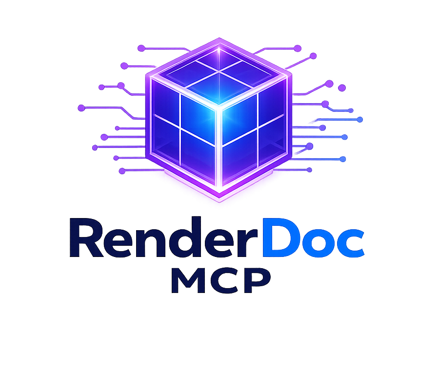
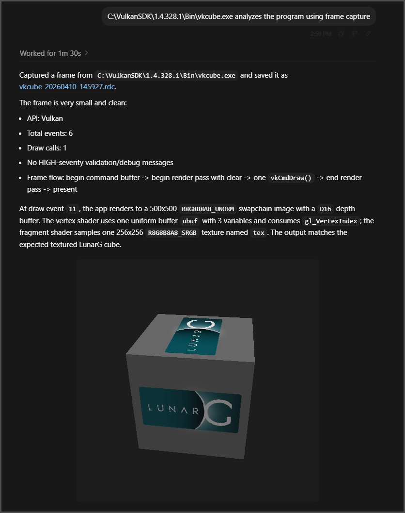
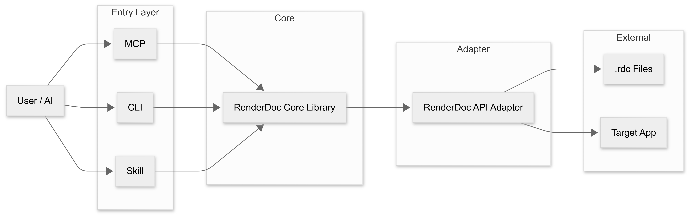

<p align="center">
  <br>
  <b>AI-native GPU frame debugging for RenderDoc</b><br><br>
  <a href="https://github.com/JiaboLi-GitHub/renderdoc-mcp/actions/workflows/ci.yml"></a>
  <a href="LICENSE"></a><br>
  <a href="https://oosmetrics.com/repo/JiaboLi-GitHub/renderdoc-mcp"></a>
  <a href="https://oosmetrics.com/repo/JiaboLi-GitHub/renderdoc-mcp"></a><br>
  <b>English</b> | <a href="README-CN.md">简体中文</a>
</p>

---

renderdoc-mcp is an MCP server and CLI that wraps the RenderDoc replay API into **59 structured tools**, letting AI assistants (Claude, Codex, etc.) open `.rdc` captures, inspect GPU frames, debug shaders/pixels, compare captures, and export evidence — all without manual UI.

## Demo

<p align="center">
  
</p>

## Features

| Area | What you can do |
|------|----------------|
| Session & Capture | Open captures, live-capture frames, inspect metadata |
| Frame Navigation | List events/draws, jump to any event |
| Pipeline & Shaders | Inspect pipeline state, bindings, shader source, constant buffers |
| Resources & Passes | Analyze frame structure, pass dependencies, resource usage |
| Pixel & Shader Debug | Pixel history, pick pixel, debug pixel/vertex/thread |
| Export | Render targets, textures, buffers, meshes, snapshots |
| Diff & Assertions | Compare captures, assert pixels/state/images for CI |

## Download

Get the latest package from [GitHub Releases](https://github.com/JiaboLi-GitHub/renderdoc-mcp/releases). The zip contains:

| File | Description |
|------|-------------|
| `bin/renderdoc-mcp.exe` | MCP server (stdio) |
| `bin/renderdoc-cli.exe` | CLI for shell & CI |
| `bin/renderdoc.dll` / `renderdoc.json` | Bundled RenderDoc runtime |
| `skills/renderdoc-mcp/` | Codex workflow skill |
| `install-codex.ps1` | One-click Codex Desktop installer |

To run CI manually, dispatch the CI workflow without a version. To also publish a release, supply a version tag (for example `v1.0.0`) and optionally select draft or prerelease. The release job runs independently of the CI jobs.

## Client Configuration

The server negotiates MCP protocol version `2025-03-26`. Clients requesting a newer version must also support this version.

### Codex Desktop

The installer auto-configures `~/.codex/config.toml`. Or add manually:

```toml
[mcp_servers.renderdoc-mcp]
command = 'renderdoc-mcp.exe'
args = []
```

### Claude Code

```json
{
  "mcpServers": {
    "renderdoc-mcp": {
      "command": "renderdoc-mcp.exe",
      "args": []
    }
  }
}
```

### Troubleshooting / Logging

Pass `--log-file <absolute path>` (or set the `RENDERDOC_MCP_LOG` environment variable) to write a timestamped log of every request, response, error and shutdown reason:

```json
{
  "servers": {
    "renderdoc-mcp": {
      "command": "renderdoc-mcp.exe",
      "args": ["--log-file", "C:\\Temp\\renderdoc-mcp.log"]
    }
  }
}
```

Native crashes inside a request (e.g. in RenderDoc's replay) are caught and returned to the client as a descriptive error instead of dropping the connection; reopen the capture afterwards. When logging is enabled, a minidump is written next to the log (`<log>.<pid>.<n>.dmp`). If the log ends without a `Server shutting down` or `FATAL` line, the process was terminated externally (for example by a client timeout).

## Build From Source

The quickest route is the official prebuilt RenderDoc (Visual Studio C++ tools and git are required):

```powershell
.\scripts\fetch-renderdoc.ps1   # downloads the version in renderdoc-version.txt into renderdoc-sdk/
cmake -B build -DRENDERDOC_DIR=renderdoc-sdk -DRENDERDOC_BUILD_DIR=renderdoc-sdk/x64/Release
cmake --build build --config Release
```

Alternatively, point `RENDERDOC_DIR` at a RenderDoc source checkout you built yourself.

| Variable | Required | Description |
|----------|----------|-------------|
| `RENDERDOC_DIR` | Yes | RenderDoc source root, or the `renderdoc-sdk` directory |
| `RENDERDOC_BUILD_DIR` | No | RenderDoc build output (if non-standard location) |

## Architecture



## License

[MIT](LICENSE). RenderDoc itself is under its [own license](https://github.com/baldurk/renderdoc/blob/v1.x/LICENSE.md).
